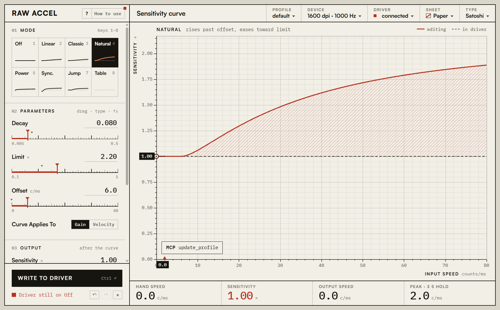

# Better Raw Accel

A new interface for [Raw Accel](https://github.com/RawAccelOfficial/rawaccel), the kernel-mode mouse acceleration driver for Windows.

The driver, the acceleration math and the settings format are Raw Accel's, untouched. This project replaces only the settings window: a live plot that morphs as you edit, a marker that follows your hand speed, profiles, per-mouse settings, five themes, an MCP server so AI tools can drive the window, and an updater.



> Raw Accel is the work of simon (a1xd), \_m00se\_, Sidiouth, TauntyArmordillo, Kovaak and contributors. See [CREDITS.md](CREDITS.md).

## Install

1. Download `BetterRawAccel-win-x64.zip` from [Releases](https://github.com/jeelnadaa/better-rawaccel/releases/latest).
2. Unzip it anywhere you can write to (not `Program Files`, or updates can't replace the files).
3. Run `BetterRawAccel.exe`.

If the Raw Accel driver is not installed, the app offers to run the bundled `installer.exe`. It needs administrator permission and a restart. The zip includes the signed driver, so you do not need anything from the original repository. `uninstaller.exe` removes the driver again.

Requirements: Windows 10 or 11, 64-bit, and the [WebView2 Runtime](https://developer.microsoft.com/microsoft-edge/webview2/) (already part of Windows 11).

## Using it

- **Mode tiles** — eight modes on one shared scale. Keys `1`–`8`. Each mode keeps its own values.
- **Parameters** — type an exact value, drag the ruler, or drag the parameter's name. `Shift` is fine control; double-click resets.
- **Plot** — the solid curve is what you are editing, computed by the driver's own code. The dashed curve is what the driver has now. Switch between sensitivity, velocity and gain at the top right.
- **Write to driver** — button or `Ctrl`+`Enter`. The driver waits one second before using new settings (Raw Accel's anti-abuse delay, kept as is).
- **Undo / redo** — `Ctrl`+`Z`, `Ctrl`+`Y`.
- **Title block** — Profile, Device, Driver (start-up, MCP, updates, import/export), Sheet (theme), Type (typeface).
- **`?`** — every control and shortcut on one sheet.

The driver forgets its settings on every restart. Tick *Apply my settings when I sign in to Windows* under **Driver** to have Raw Accel's `writer.exe` apply them at logon.

Raw Accel's own [guide](doc/Guide.md) and [FAQ](doc/FAQ.md) explain what each acceleration mode does.

## MCP

The running app hosts a [Model Context Protocol](https://modelcontextprotocol.io) server. It is not a separate headless process: tools act on the open window, so you watch every change happen, and nothing reaches the driver until `apply` is called.

Endpoint: `http://127.0.0.1:47700/mcp` (Streamable HTTP). The port and an on/off switch are under **Driver**.

Claude Code:

```bash
claude mcp add --transport http rawaccel http://127.0.0.1:47700/mcp
```

Claude Desktop, Cursor, VS Code, Gemini CLI and others: see **[doc/MCP.md](doc/MCP.md)** for the config of each, a connection test, example prompts and troubleshooting.

Tools:

| Area | Tools |
|---|---|
| Read | `get_state`, `list_modes`, `get_profile`, `get_curve`, `evaluate`, `get_live_input`, `capture_window` |
| Edit | `update_profile`, `set_mode`, `undo`, `redo`, `revert` |
| Driver | `apply`, `reset_driver` |
| Profiles | `list_profiles`, `select_profile`, `create_profile`, `rename_profile`, `delete_profile` |
| Devices | `list_devices`, `set_device`, `set_default_device`, `remove_device` |
| Files | `export_settings`, `import_settings` |
| App | `get_app_settings`, `set_app_settings` (theme, typeface, plot view), `show_panel`, `check_for_updates`, `install_update` |

Safety: the server listens on the loopback address only and refuses requests whose `Host` or `Origin` is not local. Any program on your PC can already talk to the Raw Accel driver directly, so MCP adds convenience, not privilege. Turn it off under **Driver** if you do not use it.

## Updates

Every push to `main` builds a release (see [`.github/workflows/release.yml`](.github/workflows/release.yml)). The app checks GitHub for a newer release at start-up, downloads it, verifies it against the SHA-256 published with the release, and swaps the files when you close the app. You can also install at once, or switch automatic updates off, under **Driver**.

The hash check protects against a damaged download. It does not prove who published the release.

## Build

Needs the .NET SDK and the .NET Framework 4.8 targeting pack (Visual Studio's ".NET desktop development" workload has both).

```bash
dotnet build src/BetterRawAccel/BetterRawAccel.csproj -c Release -p:Platform=x64
```

The app lands in `src/BetterRawAccel/bin/x64/Release`. A local build is version 0.0.0 and never updates itself.

Layout:

- `src/BetterRawAccel` — the host app (C#, .NET Framework 4.8, WebView2)
  - `Core/Engine.cs` — settings, validation and curves through `wrapper.dll`
  - `Core/Api.cs` — one list of operations shared by the window and MCP
  - `Core/McpServer.cs`, `Core/Updater.cs`
  - `ui/` — the interface (plain HTML, CSS and JavaScript, no build step)
- `vendor/rawaccel` — Raw Accel v1.7.1 binaries, unchanged
- `design/prototype.html` — the approved design prototype
- `doc/` — Raw Accel's guide and FAQ
- [`CHECKLIST.md`](CHECKLIST.md) — what is done and what is not

## Notes

- **Anti-cheat:** this ships the same signed driver as Raw Accel. Raw Accel's own statement on anti-cheat applies; this project changes nothing about how input is modified.
- **Fonts:** Archivo and IBM Plex Mono are bundled (SIL Open Font License), so the app works offline. Satoshi and Cabinet Grotesk are loaded from Fontshare and cached, not bundled, because their licence does not clearly allow redistribution; offline and uncached they fall back to Archivo.
- **Settings:** `settings.json` sits next to the exe in Raw Accel's own format, so it works with `writer.exe` and can be exchanged with the original GUI.

## Licence

MIT. See [LICENSE](LICENSE) and [CREDITS.md](CREDITS.md).
